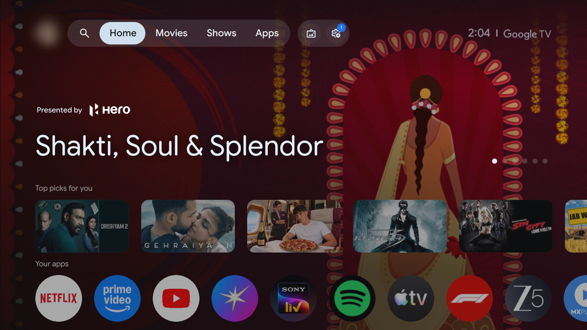
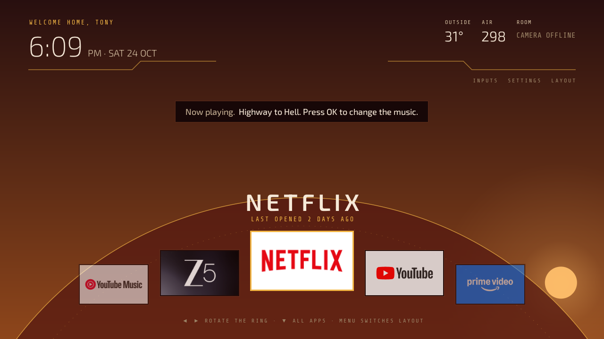
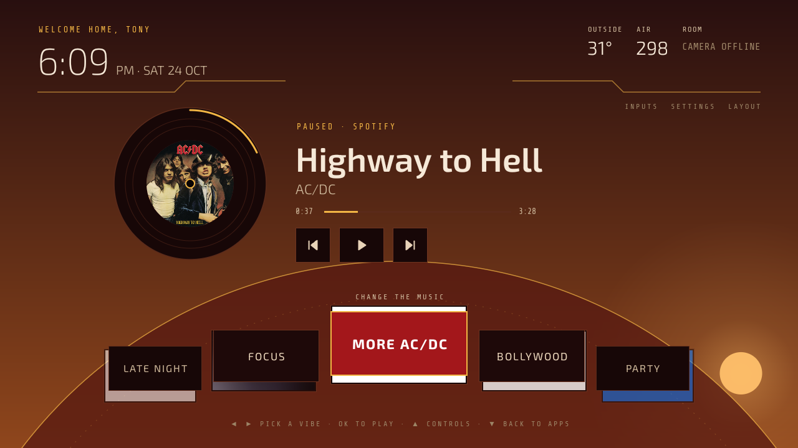
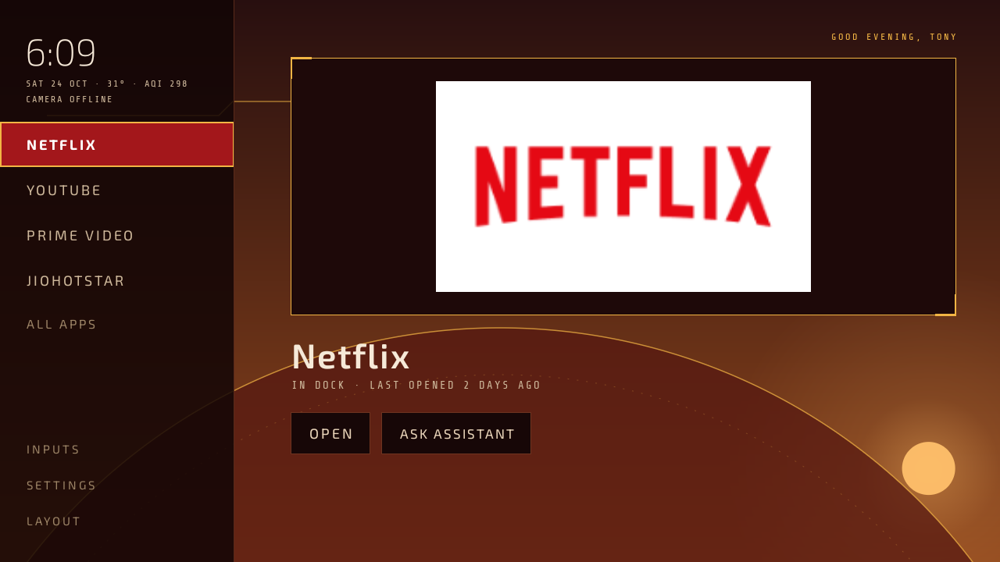
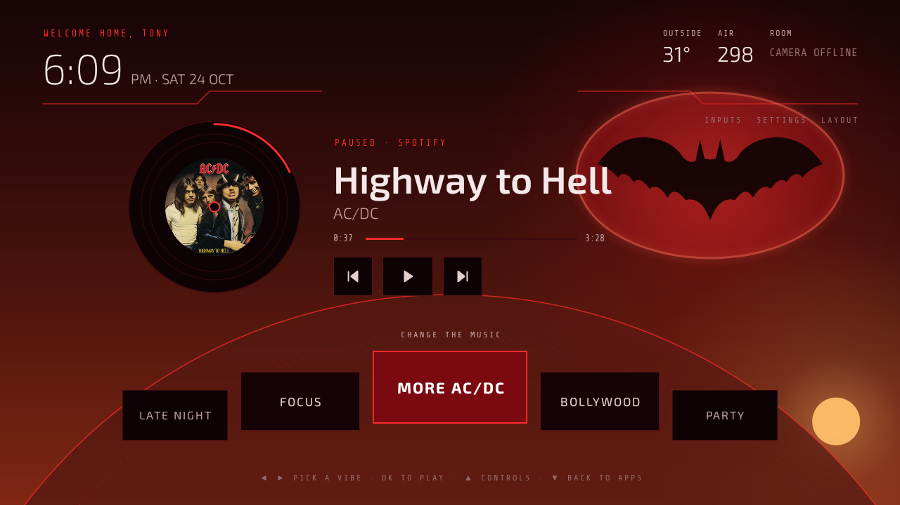
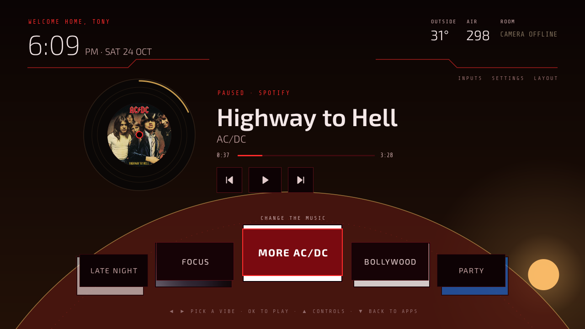
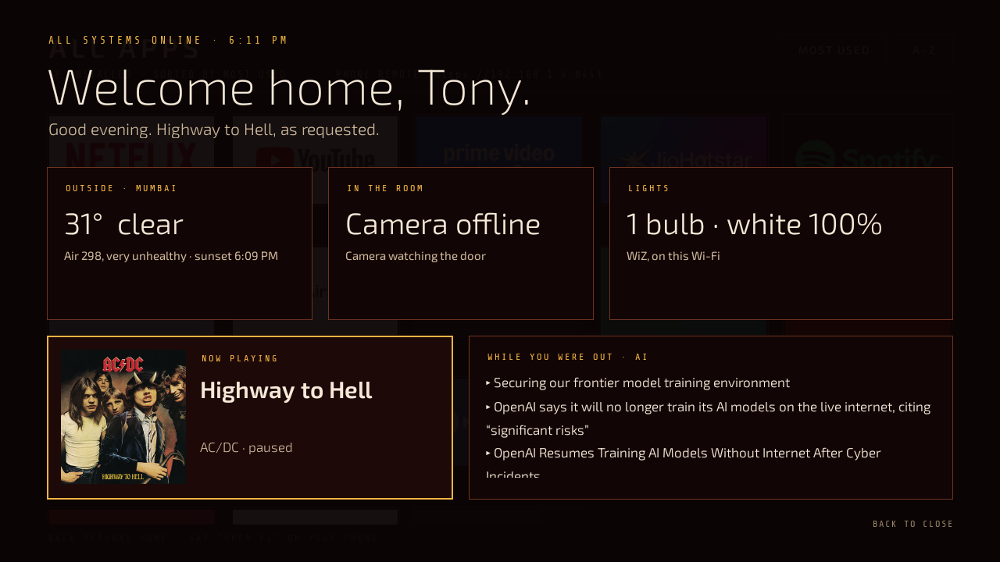
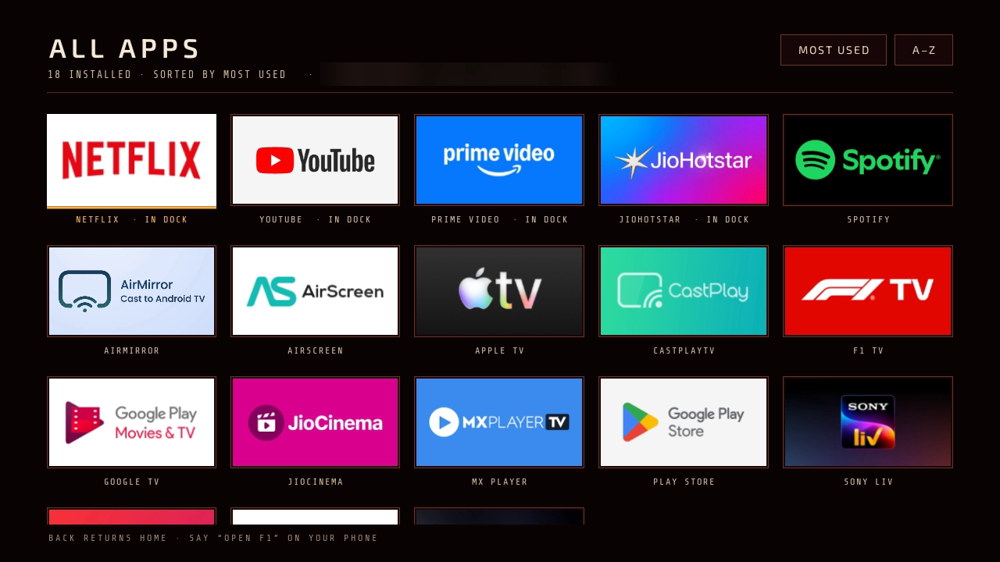

# Armour TV

My Croma 2K Google TV, turned into an Iron Man / Batman style home screen with an AI assistant that
controls the TV, the apps and the lights. I vibecoded all of it with Claude Code: no root, no custom
firmware, just the TV's developer mode and ADB over Wi-Fi.

| Before: the stock Google TV home | After: Armour |
|---|---|
|  |  |

## What it does

- **New home screen.** A curved ring of apps with the focused one raised in the middle, a side-rail
  layout (Menu switches between them), all apps, inputs, a sky that follows the real sunrise and sunset,
  the weather and air quality, and a clock screen at night.
- **Voice.** "Play Panchayat", "play Arijit on Spotify", "play the latest Two Minute Papers video",
  "turn off the TV in 30 minutes", "volume 20", "skip this song". DeepSeek v4.1 Flash on OpenRouter
  turns what you say into actions the TV carries out.
- **It uses the remote for you.** For things inside apps, like "turn on captions", an agent takes a
  screenshot, picks the next button and presses it. It decides with Jev 1.14 by TypeSafe, through
  OpenRouter: about 2-3 seconds a step, where a vision LLM took 8-10.
- **Smart lights.** Philips WiZ bulbs on the same Wi-Fi are found by themselves and controlled straight
  over the local network: colours, warm or cool white, brightness.
- **Scenes.** One sentence changes the lights, the music and the look of the TV together.
  - "Wake up, daddy's home": Highway to Hell, the lights flash, a welcome dashboard.
  - "I am Batman": red lights, the Batman theme, a Gotham-red home screen with a bat signal.
  - "Movie night": candle-warm lights at 10% and a dim cinema look.
  - "Back to normal": everything goes back the way it was.
- **Music changer.** While Spotify plays, the home screen shows a spinning disc with the song, playback
  controls and a row of vibes to switch to.
- **Phone remote.** Open the TV's address on your phone and pair with the code shown on the TV. You get
  a D-pad, a touch pad, wrist-twist volume, voice, and you can throw a photo, a link or slides at the TV.
- **Present.** Send a PDF and change slides with the remote's arrows, or send a video to play on a loop.
- **Control it from a computer or a bot.** The `tv` command: `tv "I am Batman"`, `tv key home`,
  `tv present deck.pdf`. Any agent that can run a command on your computer (Grok Bot, Claude Code) can
  run your TV.
- **Webcam, optional.** A USB webcam counts the people in the room and measures how dark it is, on the
  TV itself. No picture is saved or sent anywhere.

| Music changer | Side-rail layout |
|---|---|
|  |  |

| "I am Batman" | "Movie night" |
|---|---|
|  |  |

| "Wake up, daddy's home" | All apps |
|---|---|
|  |  |

## What you need

- An Android TV or Google TV on Android 9 or newer. Mine is a Croma 2K NSTV: Google TV 14, MediaTek.
- A Mac or Linux computer on the same Wi-Fi with Python 3, JDK 17 and the Android command-line tools.
  On a Mac: `brew install openjdk@17 android-commandlinetools`.
- An [OpenRouter](https://openrouter.ai) API key, for the voice assistant and the agent.
- Optional: Philips WiZ bulbs, a USB webcam, a [TypeSafe](https://typesafe.ai) key.

## Set it up

1. **Turn on developer mode on the TV.** Go to Settings › System › About, scroll to the build number and
   press OK on it 7 times. Then in Settings › System › Developer options, turn on USB debugging. On the
   Croma that alone opens ADB on port 5555 over Wi-Fi. Write down the TV's IP address from
   Settings › Network.
2. **Connect from your computer.**
   ```sh
   git clone https://github.com/ayushgml/armour-tv && cd armour-tv
   python3 -m venv tools/venv && tools/venv/bin/pip install -r tools/requirements.txt
   TV_HOST=<tv ip> tools/venv/bin/python -I tools/tv.py --probe
   ```
   The first time, the TV asks "Allow USB debugging?". Tick "Always allow" and accept.
3. **Optional: switch off the bloat.** For the Croma 2K NSTV:
   `TV_HOST=<tv ip> tools/disable.sh examples/croma-2k-nstv/debloat.txt`. Apps are disabled, not
   uninstalled, and `tools/restore.sh` with the same file brings them back. Read the notes at the top of
   the file first; one of them is about Wi-Fi.
4. **Personalise.** Run `cp armour/personal.properties.example armour/personal.properties`, then set your
   name, room name, city and its coordinates (for the weather). Git ignores this file.
5. **Add your AI key.** Save your OpenRouter key in `~/.config/vibe-tv/openrouter.key` and run
   `chmod 600` on it. The installer copies it to the TV without printing it. You can also paste it later
   in the phone remote's settings.
6. **Install.** Run `TV_HOST=<tv ip> armour/install.sh`. It builds the app, installs it, makes it the
   home screen and creates the phone remote's HTTPS certificate (a new one on every machine, never
   committed).
7. **Pair your phone.** Open `https://<tv ip>:8443` on your phone, accept the certificate warning once,
   tap pair and type the six-digit code shown on the TV.
8. **Optional: the `tv` command.**
   ```sh
   ln -s "$PWD/armour/tv" ~/.local/bin/tv
   mkdir -p ~/.config/vibe-tv && echo <tv ip> > ~/.config/vibe-tv/host
   tv pair            # a code appears on the TV
   tv pair <code>
   tv "I am Batman"
   ```

To remove Armour and get the stock home screen back: `TV_HOST=<tv ip> armour/uninstall.sh`.

How the app is put together, file by file: [armour/README.md](armour/README.md).

## Privacy and safety

- Your keys stay on your computer and your TV. Nothing in this repo contains a key, a token or a
  certificate.
- The phone remote only works over HTTPS. A new phone needs the code shown on the TV, and repeated wrong
  codes lock pairing for ten minutes.
- The webcam is read on the TV only. No picture is stored or uploaded.
- The assistant never buys, rents or subscribes to anything.

## Credits

Built with Claude Code. The ADB tools and debloat scripts started from
[Gathin23/tv-vibehack](https://github.com/Gathin23/tv-vibehack) (MIT). Fonts: Exo 2 and Share Tech Mono
(SIL Open Font License). Weather and air quality from Open-Meteo.

MIT licensed, see [LICENSE](LICENSE).
